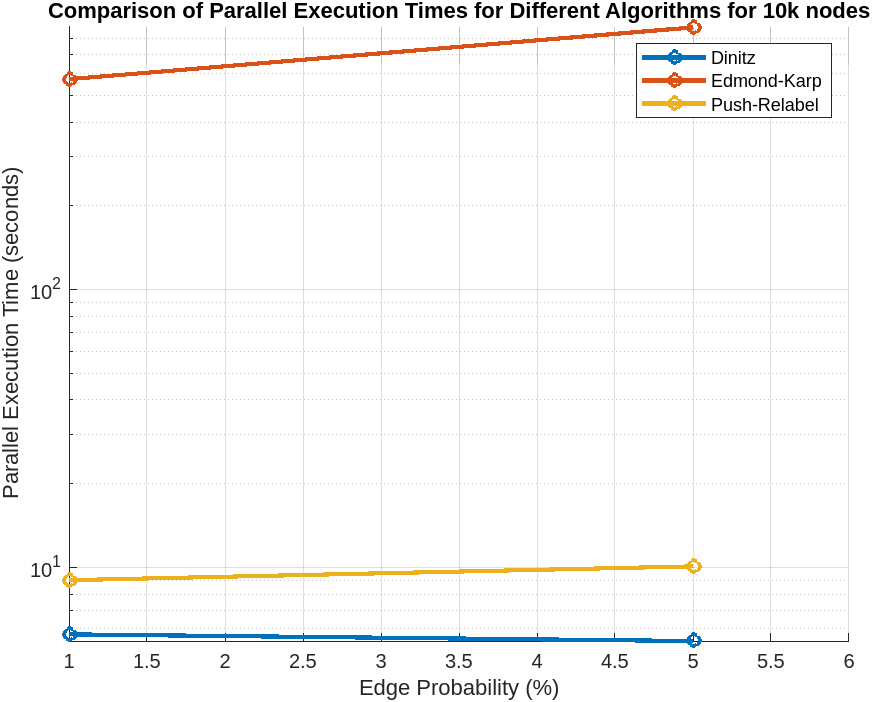
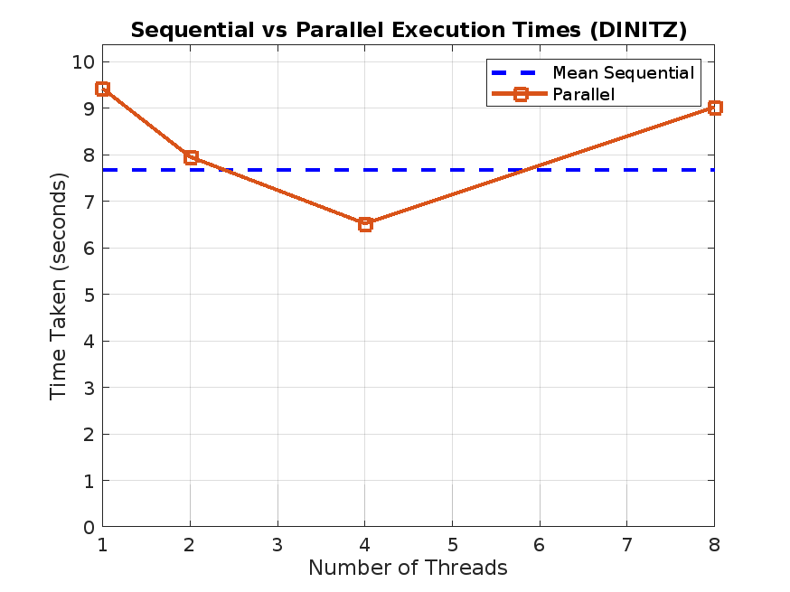
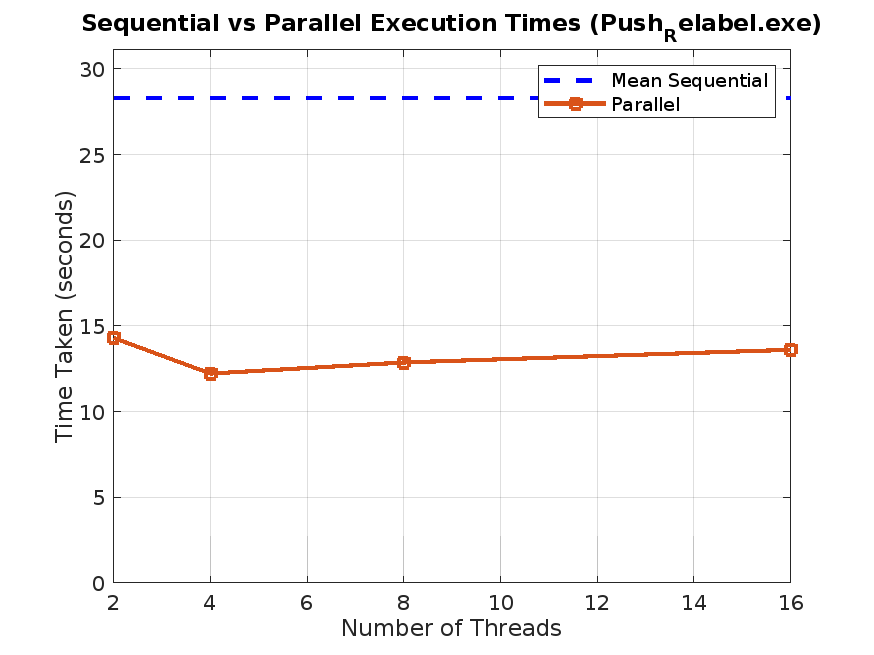
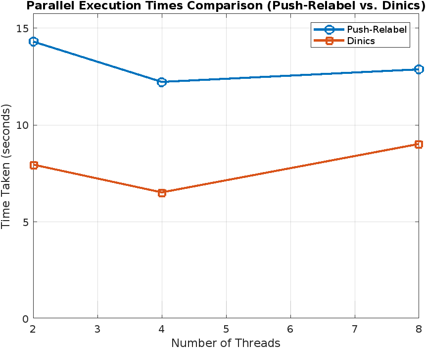

# Maximum Flow Algorithms — Sequential and Parallel C++ Implementations

**Exploring how graph algorithms behave when we introduce parallel computing.**

This university project implements and compares three approaches to the **maximum flow problem**—finding the greatest amount of flow that can travel from a source to a sink in a capacitated directed network. Beyond implementing the algorithms in C++, the project explores OpenMP-based parallelization and the trade-offs between concurrency overhead and execution time.

## What’s inside

| Algorithm | Sequential implementation | Parallel experiment |
| --- | --- | --- |
| Edmonds–Karp | `Sources/Edmonds_Karp.cpp` | `Sources/EK2.cpp` |
| Dinic’s (named Dinitz in the source) | `Sources/Dinitz.cpp` | `Sources/Dinitz2.cpp` |
| Push–Relabel | Both modes in `Sources/Push_Relabel.cpp` | Both modes in `Sources/Push_Relabel.cpp` |

The repository also includes a random graph generator, a sample network, performance plots, and longer technical documentation.

## Why this project?

A faster-looking algorithm on paper is not necessarily faster in a parallel implementation. Parallel work introduces synchronization, shared state, and scheduling overhead. The goal was to implement classic flow algorithms, experiment with OpenMP, and compare sequential and parallel execution on generated flow networks.

### Key concepts explored

- **Edmonds–Karp:** breadth-first search for augmenting paths in a residual network.
- **Dinic’s:** level graphs and blocking flows.
- **Push–Relabel:** preflow, node heights, and local push/relabel operations.
- **OpenMP:** parallel loops, thread management, critical sections, and synchronization.
- **Performance analysis:** measuring runtime and examining when parallelization helps—or adds overhead.

## Performance visualizations

The repository includes the original experiment plots:

### Edmonds–Karp


### Dinic’s


### Push–Relabel


### Cross-algorithm comparison


These are project experiment figures, **not general performance guarantees**. Runtime depends on graph topology and density, machine specifications, thread count, and implementation details.

## Repository layout

```text
Maximum-Flow-Algorithms/
├── Sources/
│   ├── Edmonds_Karp.cpp       # Edmonds–Karp experiment
│   ├── EK2.cpp                # Parallel BFS experiment
│   ├── Dinitz.cpp             # Dinic's experiment
│   ├── Dinitz2.cpp            # Parallel Dinic's experiment
│   ├── Push_Relabel.cpp       # Sequential and parallel modes
│   ├── generate_graph.cpp     # Random flow-network generator
│   └── graph.txt              # Example generated network
├── pictures/                  # Performance plots
├── DOCUMENTATION.md           # Implementation and design details
└── Overheads/                 # Project presentation
```

## Building and running

### Requirements

- C++17-compatible compiler (tested with `g++`)
- OpenMP support (for GCC, `-fopenmp`)
- A Linux-style shell for the commands below; use the equivalent executable syntax on Windows

From the repository root:

```bash
mkdir -p bin

g++ -std=c++17 -O2 -fopenmp Sources/Edmonds_Karp.cpp -o bin/edmonds_karp
g++ -std=c++17 -O2 -fopenmp Sources/EK2.cpp -o bin/edmonds_karp_parallel
g++ -std=c++17 -O2 -fopenmp Sources/Dinitz.cpp -o bin/dinic
g++ -std=c++17 -O2 -fopenmp Sources/Dinitz2.cpp -o bin/dinic_parallel
g++ -std=c++17 -O2 -fopenmp Sources/Push_Relabel.cpp -o bin/push_relabel
g++ -std=c++17 -O2 Sources/generate_graph.cpp -o bin/generate_graph
```

Run an algorithm against the included graph file (the optional final argument selects the number of OpenMP threads, defaulting to 8):

```bash
./bin/edmonds_karp Sources/graph.txt 4
./bin/edmonds_karp_parallel Sources/graph.txt 4
./bin/dinic Sources/graph.txt 4
./bin/dinic_parallel Sources/graph.txt 4
./bin/push_relabel Sources/graph.txt 4
```

### Try a small graph

Create `small_graph.txt`:

```text
4
0 1 3
0 2 2
1 2 1
1 3 2
2 3 3
0 3
```

This describes four vertices, five capacity-labeled directed edges, and source/sink vertices `0` and `3`. **The expected maximum flow is 5.**

```bash
./bin/dinic small_graph.txt 2
```

### Generate a graph

```bash
./bin/generate_graph generated_graph.txt
```

The program interactively asks for the number of vertices, edge probability (percentage), and maximum edge capacity. The generated graph uses vertex `0` as the source and vertex `n−1` as the sink.

### Graph input format

```text
<number of vertices>
<from> <to> <capacity>
<from> <to> <capacity>
...
<source> <sink>
```

**Note:** There is *no explicit edge-count line* in the format produced by the bundled graph generator. The original `README.txt` describes a different format, so this README follows the source code and actual sample file.

## Implementation notes and limitations

This repository represents an academic exploration of parallel graph algorithms, not a production-ready maximum-flow library.

- The algorithms use adjacency-matrix-style representations, which have **quadratic memory requirements** in the number of vertices, even though the generator writes only existing edges to disk.
- Some OpenMP experiments have significant synchronization or threading overhead. In particular, `Edmonds_Karp.cpp` and `Dinitz.cpp` use an OpenMP `single` region to call the sequential algorithm, so those files should **not** be presented as effective parallel speedups.
- The parallel implementations should be reviewed further for thread safety, reproducibility, and correctness on larger and adversarial graphs. The sample run is not a comprehensive test suite.
- Input parsing and validation could be made more robust, especially around interpreting the final source/sink line and invalid vertex/capacity values.
- The project currently has no automated correctness/benchmark suite. For meaningful performance comparisons, measurements should use repeated runs, a controlled machine environment, and graph datasets with known characteristics.

## Documentation

See [`DOCUMENTATION.md`](DOCUMENTATION.md) for detailed algorithm design, parallelization strategies, and discussion of the experimental results.

## Project context

Developed as an academic project at **Politecnico di Torino**, exploring algorithm engineering, parallel computing, and the practical challenges of improving performance through concurrency.
